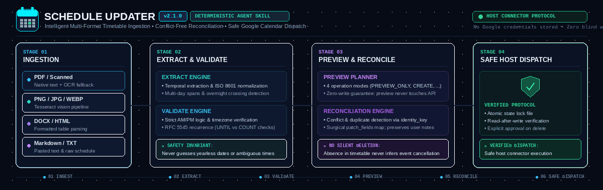

# Schedule Updater Agent Skill



> **Deterministic timetable ingestion, conflict-free reconciliation, and safe Google Calendar synchronization for agent skills.**<br>
> Supports **PDF** (native & scanned OCR), **Images** (PNG/JPG/WEBP), **DOCX**, **HTML**, **Markdown**, and pasted plain text.

**Version:** 2.1.0  
**Package type:** Agent Skill + deterministic local schedule engine  
**Calendar mutations:** performed only by the host agent's authorized Google Calendar connector

## What it does

Schedule Updater extracts schedules from PDF (including scanned pages where the OCR stack is available), PNG/JPG/JPEG/WEBP, Markdown, TXT, DOCX, HTML/HTM, and pasted text. It normalizes candidate entries, flags temporal ambiguity, prepares a reconciliation plan, and tells the host agent how to create/update events safely.

The Python engine does **not** authenticate to Google or call Calendar APIs. It performs local extraction, validation, planning, and state mapping. The host skill runtime supplies live `calendar:list_calendars`, `calendar:list_events`, `calendar:get_event`, `calendar:create_event`, `calendar:update_event`, and (only after explicit approval) delete functionality if the host provides it.

## Package layout

```text
schedule-updater/
├── SKILL.md
├── README.md
├── CHANGELOG.md
├── AUDIT_REMEDIATION.md
├── VALIDATION_REPORT.md
├── pyproject.toml
├── LICENSE
├── references/
│   ├── EVENT_SCHEMA.md
│   ├── RECONCILIATION.md
│   └── ERROR_HANDLING.md
├── scripts/
│   └── schedule_engine.py
├── tests/
│   └── test_schedule_updater.py
├── examples/
│   ├── sample_timetable.md
│   └── sample_existing_events.json
└── .gitignore
```

## Requirements

- Python 3.10 or newer.
- Core engine: Python standard library only.
- Optional document parsers:
  - PDF: `pdfplumber`.
  - Scanned PDF fallback: `pypdfium2`, `Pillow`, `pytesseract`, plus the system Tesseract OCR executable.
  - Images: `Pillow`, `pytesseract`, plus the system Tesseract OCR executable.
  - DOCX: `python-docx`.
  - HTML: `beautifulsoup4`.
- Live Google Calendar actions: a host-provided connected connector with appropriate permission. No Google credentials are stored by this package.

Install only the dependencies needed for the formats you use:

```bash
python3 -m pip install -e '.[pdf,ocr,docx,html]'
```

Installing `ocr` also requires the system Tesseract executable, which must be installed through the host OS's package manager. Do not install system packages automatically through this skill.

## Install into an Agent Skills host

1. Extract this ZIP.
2. Copy the `schedule-updater/` directory to the host's supported skills directory.
3. Confirm the host indexes `SKILL.md` and recognizes `name: schedule-updater`.
4. Ensure the supporting `scripts/` and `references/` directories remain available at the installed skill root. Some hosts snapshot only `SKILL.md`; for those hosts, place companion files at a stable supported path and adjust the skill's engine-root reference explicitly. Do not assume the current working directory is the skill root.
5. Confirm the actual Calendar tools are registered and their schemas match the workflows described in `SKILL.md`.
6. Run the local test suite before enabling live mutations.

The `allowed-tools` frontmatter is host-specific/experimental. Retain or adapt it to the installation host's documented format; do not assume every Agent Skills host interprets it identically.

## Usage examples

- `Import this timetable into my Google Calendar.`
- `Reconcile this revised schedule with my Google Calendar.`
- `Update only existing events from this revised timetable; do not create new events.`
- `Preview the events in this schedule without changing my calendar.`

## CLI

### Extract a file

Create a private per-run working directory so parallel imports do not share intermediate files:

```bash
RUN_DIR="$(mktemp -d "${TMPDIR:-/tmp}/schedule-updater.XXXXXX")"
chmod 700 "$RUN_DIR"
python3 scripts/schedule_engine.py extract \
  --input ./examples/sample_timetable.md \
  --source-id mbbs-study-schedule \
  --timezone Asia/Kolkata \
  --output "$RUN_DIR/extracted.json"
```

### Extract pasted text safely

Write pasted text to a controlled temporary file with the host file tool, then pass that path to `--input`. Alternatively, pipe stdin to `--input -` if the host shell tool safely supports stdin. **Never interpolate raw pasted text into a shell command.**

### Preview (no existing events required)

```bash
python3 scripts/schedule_engine.py reconcile \
  --extracted "$RUN_DIR/extracted.json" \
  --state-file ~/.schedule_updater_state.json \
  --calendar-id primary \
  --mode PREVIEW_ONLY \
  --output "$RUN_DIR/plan.json"
```

### Reconcile with a connector-produced event snapshot

```bash
python3 scripts/schedule_engine.py reconcile \
  --extracted "$RUN_DIR/extracted.json" \
  --existing "$RUN_DIR/existing-events.json" \
  --state-file ~/.schedule_updater_state.json \
  --calendar-id primary \
  --mode RECONCILE \
  --output "$RUN_DIR/plan.json"
```

The `source-id` should be a stable logical schedule identity reused across revised uploads (and different IDs should be used for separate schedules even if filenames match). The existing-events JSON must contain all pages in the relevant range and any state-mapped events fetched by ID. The engine does not fetch events itself.

### Inspect state mappings

```bash
python3 scripts/schedule_engine.py state-list \
  --state-file ~/.schedule_updater_state.json \
  --calendar-id primary \
  --source-id mbbs-study-schedule
```

### Record a verified event mapping

The host may call `record-verified` only after the real calendar write was read back and core fields were compared. Write the actual and expected event resources to private JSON files and pass file paths, not inline event JSON. This command requires `--source-id` so the state mapping is isolated to the logical schedule.

```bash
python3 scripts/schedule_engine.py record-verified \
  --state-file ~/.schedule_updater_state.json \
  --calendar-id primary \
  --slot-key '<slot-key-from-plan>' \
  --anchor-key '<anchor-key-from-plan>' \
  --source-id mbbs-study-schedule \
  --identity-key '<identity-key-from-plan>' \
  --source-name 'sample_timetable.md' \
  --actual-event-json "$RUN_DIR/verified-actual-event.json" \
  --expected-event-json "$RUN_DIR/expected-event.json"
```

## Safety model

- The engine never invokes a Calendar API.
- `PREVIEW_ONLY` performs no calendar reads or writes.
- The user-requested mode is explicit and hard-enforced by the engine's plan logic.
- `CREATE_ONLY` never creates updates; `UPDATE_EXISTING` never creates unmatched events.
- Ambiguities are retained and reported.
- Blank or unspecified description/location fields never clear existing content. Plans expose `patch_fields`; description replacement and recurrence changes require confirmation. If the source omits recurrence while a mapped existing event is recurring, the plan asks for clarification.
- The default workflow does not delete events.
- No implicit deletion is inferred from a revised document's omissions.
- State stores event mapping metadata, never credentials.
- Write results must be verified by the host agent before state is recorded.
- Uncertain create outcomes are reconciled before retries.

## Tests

```bash
python3 -m unittest discover -s tests -v
```

Tests use generated local files and mocked data. They do not connect to or mutate a real Google Calendar.

## Limitations

- Table extraction is conservative; uncommon layouts may need visual review or custom parsing.
- OCR quality depends on image clarity, language support, and the system OCR binary.
- The engine currently parses a conservative subset of RFC 5545 recurrence rules, not every possible extension.
- Host connector pagination, authentication, write semantics, and notification behavior must be verified separately against the actual tool schema.
- Local idempotency cannot mathematically guarantee exactly-once remote creation if the host loses the remote result before state commit. The workflow uses markers, mappings, and reconciliation to reduce that risk and stops when the result remains uncertain.
